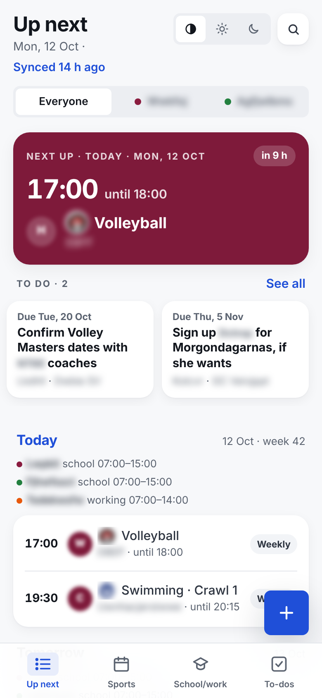
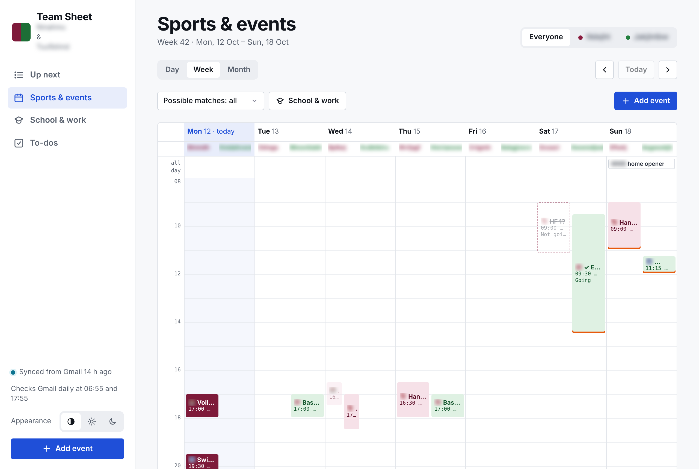
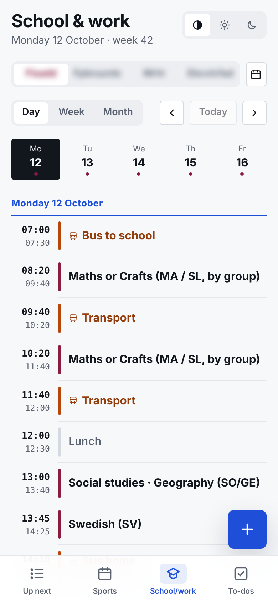
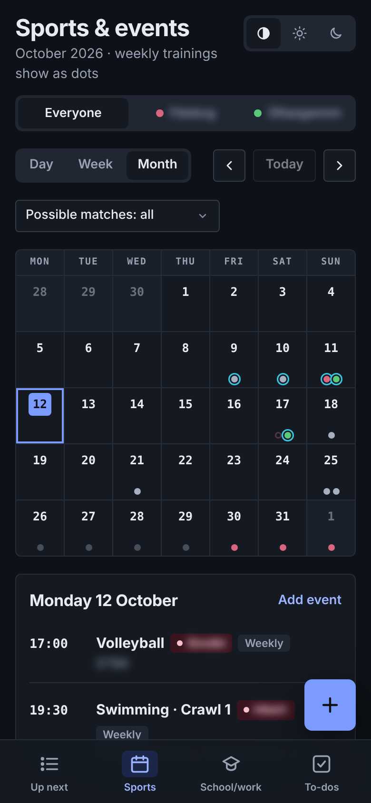
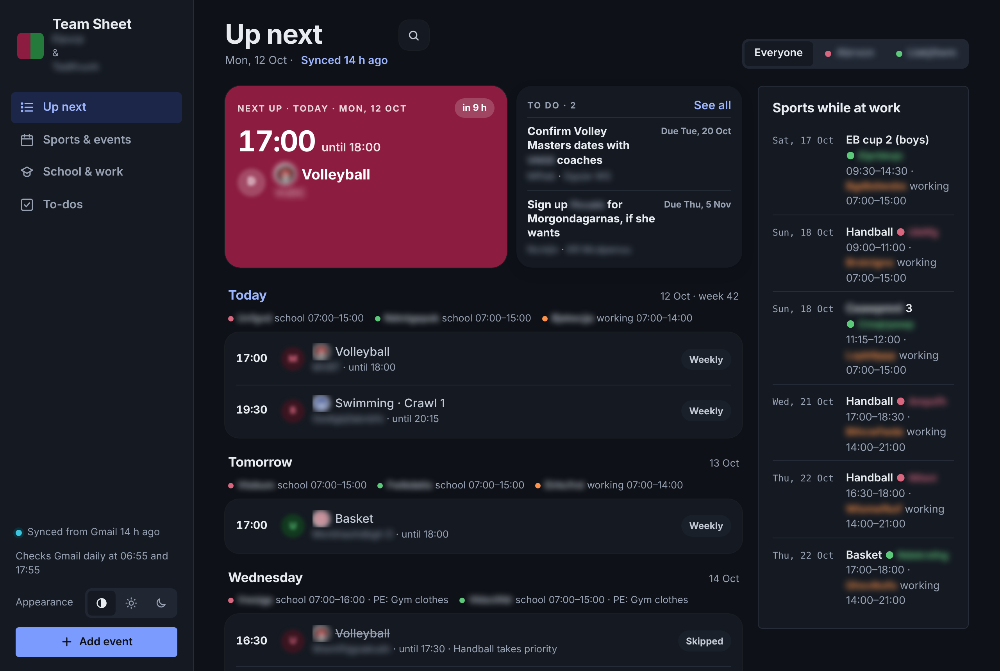

# Family Team Sheet

A shared board for two kids' sports, school and parties. It is kept up to date from Gmail by a scheduled Claude task and mirrored into a shared Google calendar for phone reminders. The board is a single HTML page published as a [Claude artifact](https://claude.ai). It keeps its data in the artifact's own database, so there's no server to run.

Everything personal (names, email addresses, clubs, school, calendar id, the board's link) lives in `private/`, which git ignores. The repository holds templates, and a small build script fills them in. `private.example/` shows what goes in `private/`, the way `.env.example` does for a `.env` file.

| Up next (phone) | Week (desktop) |
|---|---|
|  |  |

| School & work | Month (dark) | Overview (desktop, dark) |
|---|---|---|
|  |  |  |

*Screenshots of a real board, with names, places, clubs and logos blurred by `scripts/screenshots.py`.*

```
Gmail ──(twice a day)──► Gmail → board sync ──► board database ◄──► board page (Claude artifact)
                                                     │                 used by both parents
                                                     ▼
                         Board → calendar sync ──► shared Google calendar ──► phone reminders
```

## What's in here

| Path | What it is |
|---|---|
| `board/index.src.html` | The board page (HTML, CSS and JS in one file) with `{{placeholders}}` |
| `tasks/*.md` | The scheduled tasks: settings plus the prompt template |
| `private.example/` | What `private/` holds: a fictional `family.json`, `logos.json` and `league_games.txt`, and a README describing every field |
| `config/sample-db.json` | Fictional board data for trying the page locally |
| `scripts/build_board.py` | Fills the templates → `dist/index.html` and `dist/tasks/*.txt` |
| `scripts/check_private.py` | Fails if a personal value from `private/family.json` is in a file git would commit |
| `scripts/preview.py` | Wraps the built page with an in-memory stand-in for Claude so it opens in any browser |
| `scripts/screenshots.py` | Screenshots of your board with personal details blurred |
| `scripts/calendar_plan.py` | Dry run of the calendar rules against a dump of the board's data |
| `scripts/league_fixtures.py` | Turns a league schedule into "possible match day" events |
| `scripts/logos/` | Tests for matching team names to club logos |
| `docs/` | Data model, design decisions, logos |

## Try it

```bash
python3 scripts/build_board.py --config private.example/family.json
python3 scripts/preview.py --now 2026-10-12T08:00:00+02:00
open dist/preview.html
```

## Set it up for your family

You need a Claude plan with artifacts and scheduled tasks, plus the Gmail and Google Calendar connectors.

1. `cp -r private.example private` and fill in `private/family.json` (every field is explained in `private.example/README.md`). Kids, adults and clubs need short lower-case ids; they are stored in the data and used as CSS classes, so don't change them later. The `prompt` section holds the paragraphs that describe your clubs and school to the Gmail task. Write them the way you'd brief a new babysitter.
2. `python3 scripts/build_board.py`
3. In Claude, publish `dist/index.html` as an artifact with the capabilities `db`, `user`, `downloads` and `sample` (images on). Put its link in `board.artifact_url` and build again. Leave out `assets` (screenshots attached to events): uploaded files can stop the board from being shared by invitation, and the board simply hides the attach buttons without it. Never put `data:` URLs in the page: claude.ai refuses to share pages that contain them (the build checks this). Share with the other parent as **Editor** if they should be able to answer Going / Not going, tick to-dos or add events; Viewers and Commenters can only read.
4. Create a Google calendar for the reminders (or use an empty one) and put its id in `calendar.id`.
5. Create the scheduled tasks from `tasks/*.md`: the settings are in each file's table, and the text to paste is in `dist/tasks/<name>.txt`. Give the Gmail task the Gmail connector and the calendar task the Google Calendar connector.
6. Optional: forward invitations to a `+board` alias of your address (`board.forward_email`); the Gmail task turns every message sent there into an event.

Colours live at the top of `board/index.src.html` (`--k1`, `--k2` for the kids, `--a1`, `--a2` for the adults).

## Changing the board

1. Edit `board/index.src.html` (never `dist/`).
2. `python3 scripts/build_board.py`, then check it with `scripts/preview.py`.
3. Publish `dist/index.html` to the same artifact. It must stay **one file**: supporting files published next to it are refused ("Forbidden") for people the board is shared with.
4. If you changed a task template, paste the new `dist/tasks/<name>.txt` into that scheduled task.
5. Note the change in `CHANGELOG.md`.

Republishing never touches the data: the page reads everything from the artifact database.

## Keeping personal data out of git

- `private/` and `dist/` are in `.gitignore`.
- Run `python3 scripts/check_private.py` before committing, or install it as a hook: `ln -s ../../scripts/check_private.py .git/hooks/pre-commit`.
- Add anything else that identifies you (surname, school, town, club names) to `private_terms` in `private/family.json`, so the check looks for it too.

## Club logos

The board shows club logos next to events and opponents. Logos are the clubs' property, so they aren't in this repository. Put your own collection in `private/logos.json` (format and sources in `docs/logos.md`); the example folder has a few made-up ones. Without it the board shows initials instead.

## Licence

MIT, see `LICENSE`.

## Screenshots of your own board

```bash
pip install playwright pillow && python3 -m playwright install chromium
python3 scripts/screenshots.py --data db --now 2026-10-12T08:00:00+02:00   # db = ArtifactData dump
```

Every private value, place, team and club name is replaced by random letters of the same length, then blurred; logos and initials are blurred too. Look at the images before committing them: the script only hides words it knows about.
